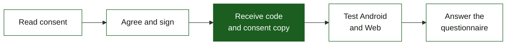

<div align="center">


# MerkadoGo Forms

**Consent first. Test both platforms. Share your feedback.**

A consent and evaluation companion for the<br>
**Ligao City Public Market smart market guide.**

[Overview](#overview) · [Participant journey](#participant-journey) · [Architecture](#architecture) · [Roadmap](#roadmap) · [Development](#development)

</div>

> [!NOTE]
> **Phase 1 preparation is complete.** The consent website is still being planned; its interface, backend, and private storage have not been implemented or deployed. Phase 2 will finalize the detailed design.

## Overview

MerkadoGo Forms supports the remaining **17 shoppers** participating in the evaluation of **MerkadoGo: Android-Based Smart Market Guide for Ligao City Public Market.**

The planned website brings consent reading, electronic signing, participant-code delivery, and application access into one guided journey. Researchers will share the same website link with scheduled groups. Shoppers will not be required to sign into Google or create a website account.

Each shopper will test **both Android and Web**, then submit **one questionnaire** with separate ratings for each platform. The existing Google Form remains the evaluation destination.

## Participant journey



| Step | Planned experience |
| --- | --- |
| **Read** | Review the study information and researcher contacts; agree or decline. |
| **Sign** | Enter a full name, draw a signature, and explicitly agree. Signing time is recorded automatically; no witness field is included. |
| **Keep a copy** | After successful saving, receive one code from **S01–S17** and a copy of the completed consent. |
| **Test** | Follow the existing ten tasks on both application versions. |
| **Evaluate** | Use the assigned code in the existing questionnaire. Ratings and feedback remain optional. |

Declining ends participation before testing. One code belongs to one shopper and covers both platforms.

## Architecture

The selected stack keeps the interface simple and separates private consent records from questionnaire responses.

| Layer | Selected technology | Responsibility |
| --- | --- | --- |
| **Interface** | HTML · CSS · JavaScript | Responsive consent page and canvas signing |
| **Hosting and backend** | Google Apps Script | Server validation, code allocation, saving, and PDF creation |
| **Consent records** | Restricted Google Drive | Completed consent PDFs and versioned consent sources |
| **Private register** | Restricted Google Sheets | Code-to-participant matching and consent status |
| **Evaluation** | Existing Google Form + response Sheet | Separate Android and Web ratings and feedback |

<details>
<summary><strong>Record integrity and privacy</strong></summary>

- Consent must be recorded before application testing.
- Codes are allocated on the server, with protection against concurrent assignment and repeated submissions.
- Success is shown only after the consent PDF and register entry are both saved.
- Participant copies require access to that specific record; a sequential code is not a download credential.
- Names, signatures, completed PDFs, and the private register stay separate from the public repository and rating dataset.
- Researchers review response matching and duplicates manually.

</details>

## Roadmap

| Phase | Focus | Status |
| --- | --- | --- |
| **01** | Dependencies, folder structure, and project preparation | **Complete** |
| **02** | Participant flow, consent wording, data model, and backend design | **Next** |
| **03** | Consent reading, signing, and reliable saving | Planned |
| **04** | Private participant copy and recovery | Planned |
| **05** | Application access and questionnaire handoff | Planned |
| **06** | Verification and controlled rehearsal | Planned |
| **07** | Authorized release and handover | Planned |

The local implementation plan breaks these phases into **24 smaller tasks**, each with acceptance criteria, dependencies, and verification. Work proceeds one approved task at a time.

## Development

Phase 1 established the local planning package, source/test preparation folders, dependency inventory, and inert configuration examples. The initial stack requires no frontend framework or npm runtime packages. Product coding comes after the design review.

<details>
<summary><strong>Prepared local workspace</strong></summary>

```text
MerkadoGo_online_form/
├── README.md
├── AGENTS.md
├── MASTER_SESSION_PROMPT.txt
├── TECH_STACK.md
├── DESIGN_REFERENCE.md
├── .agents/              Installed project skills
├── apps-script/          Source-layout guide and configuration examples
├── docs/                 Flow, data, backend, dependencies, verification
├── tasks/                Master plan, progress, findings, phase tasks
├── tests/                Isolated verification scope
└── logo/                 Original local branding assets
```

This is the local workspace structure. **The initial GitHub publication contains only this README**; the other files remain local. The header uses a logo already hosted by the MerkadoGo application.

</details>

Access without Google sign-in under the researchers' BU account, private-copy delivery, and the final consent/storage arrangements will be verified before release. Configuration examples are preparation artifacts, not a working deployment.

<div align="center">

**MerkadoGo · Ligao City Public Market**<br>
[Open the existing MerkadoGo Web Application](https://merkado-go.web.app)

</div>
